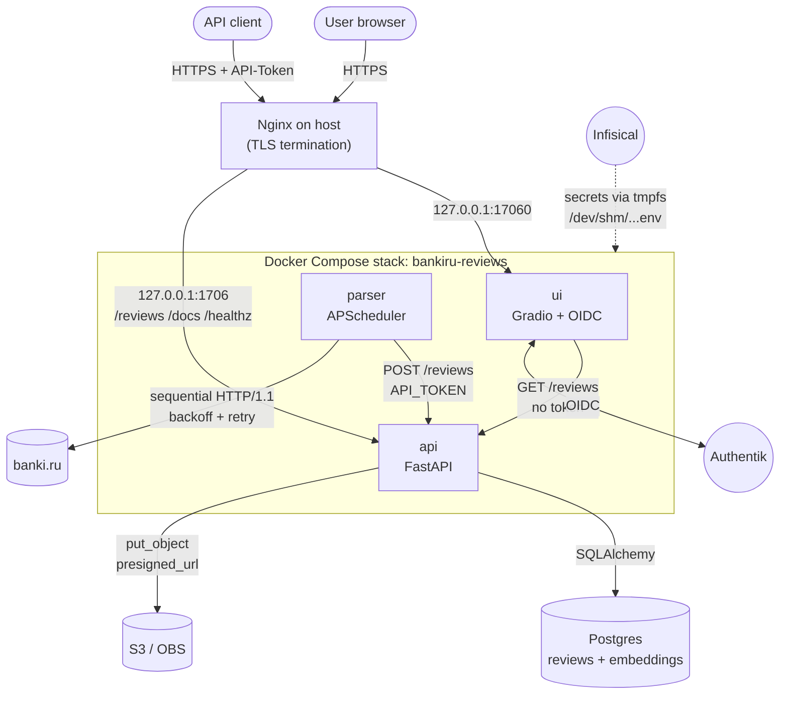

<!-- bankiru-reviews README — explicit <a id> anchors for TOC; section headers use · [↑](#toc). -->
<p align="center">
  
</p>

<h1 align="center">bankiru-reviews</h1>

<p align="center">
  Dockerized stack that collects negative customer reviews from
  <a href="https://www.banki.ru">banki.ru</a>, stores them in Postgres,
  and serves filtered, LLM-summarized exports through a Gradio web UI
  gated by <a href="https://goauthentik.io/">Authentik</a> OIDC, with
  all secrets pulled at start-up from a self-hosted
  <a href="https://infisical.com/">Infisical</a> instance into tmpfs.
</p>

<p align="center">
  
  
  
  
  
</p>

---

<a id="toc"></a>

## Table of contents

- [Как это работает (обзор)](#как-это-работает-обзор)
- [Architecture at a glance](#architecture-at-a-glance)
- [Stack overview](#stack-overview)
- [Repository layout](#repository-layout)
- [Quick start](#quick-start)
  - [Production (with Infisical)](#production-with-infisical)
  - [`start.sh` flags](#startsh-flags)
  - [Local development (without Docker)](#local-development-without-docker)
  - [Tests](#tests)
- [Secrets](#secrets)
- [Nginx](#nginx)
- [Operations](#operations)

The long API, parser, and day-2 notes are in [`docs/operations.md`](docs/operations.md). The longer Russian text is in [`docs/overview.ru.md`](docs/overview.ru.md). Collection policy: [`docs/collection-policy.md`](docs/collection-policy.md). Public API: [`docs/bankiru-reviews-public-api.md`](docs/bankiru-reviews-public-api.md).

---

<a id="как-это-работает-обзор"></a>
## Как это работает (обзор) · [↑](#toc)

bankiru-reviews каждый день забирает с banki.ru отзывы с оценками 1 и 2 и показывает их на https://bankiru.uva-advanced.ru. Снаружи стоит Nginx на хосте. Он завершает TLS и пускает людей в веб-интерфейс через Authentik. За ним на loopback работают три контейнера: ui на `127.0.0.1:17060`, api на `127.0.0.1:1706` и parser. Секреты хранятся в Infisical и при старте попадают во временный файл `/dev/shm/bankiru-reviews-secrets/.env`, а не в git. Развёрнутый русский текст лежит в [`docs/overview.ru.md`](docs/overview.ru.md).

---

<a id="architecture-at-a-glance"></a>
## Architecture at a glance · [↑](#toc)



**Request path for a UI query:**

1. Browser → Nginx (TLS) → `ui` service (`127.0.0.1:17060`).
2. Gradio calls `GET /reviews` on the `api` service (internal compose network, no `API-Token`). The Format dropdown defaults to `parquet`, and `summarize` is sent explicitly (`true` only when a real **Summary model** is selected). Clearing Format omits `outputFormat`, so the API answers inline.
3. `api` queries Postgres, optionally runs the LLM when `summarize=true`, then either returns rows inline or uploads the export to S3 and returns a pre-signed URL — JSON body `{url, comment, …}` or `{reviews, comment, …}`. An omitted date bound always resolves to the matching bound of the stored data (omitted `startDate` = earliest `datePublished` in DB, omitted `endDate` = the latest one), whatever `summarize` is; the resolved range drives the SQL filter and is echoed back in the response. An inverted effective range returns **400**, and with `summarize=true` a span longer than three calendar months returns **400** before the main select/LLM.
4. On success, UI renders the summary in the Markdown panel (empty when `<no summary>`) and may show an info toast **"Download your file"** only when an export URL is present. On API/network failure the UI raises a Gradio **error toast** with the API `detail` (not Summary text), clears the signed URL and Summary, and does not show the download info toast. "Download reviews" opens the pre-signed URL in a new tab (**browser → OBS**, no server round-trip). "Download summary" saves the Summary Markdown as a local `.md` (client-side Blob).

**Request path for an external API client:** Browser/script → Nginx (TLS) → `api` (`127.0.0.1:1706`) with `API-Token` (guest or admin). Omitting `outputFormat` returns reviews **inline** in `reviews`. Omitting `summarize` is always **`false`** (gateway, localhost, or UI). Omitting a date bound resolves it to the earliest / latest stored review date, which is also what the response echoes back — a breaking change, since those fields are no longer `null`. Unknown query params → **422**. An inverted effective range → **400** (previously an empty 200); `summarize=true` with an effective date span &gt; 3 calendar months → **400** with a fixed `detail` string (same for Nginx, localhost, and Gradio); a `keywords` query the embedding provider cannot embed → **503** (previously an empty 200). Full guide: [`docs/bankiru-reviews-public-api.md`](docs/bankiru-reviews-public-api.md).

---

<a id="stack-overview"></a>
## Stack overview · [↑](#toc)

| Service | Where it listens | Role |
|---------|------------------|------|
| `api` | `127.0.0.1:1706` | FastAPI. Inserts reviews, serves filters and exports, optional summary. |
| `parser` | no host port | Daily crawl of banki.ru, then `POST /reviews`. |
| `ui` | `127.0.0.1:17060` | Gradio. Authentik OIDC. Calls `api` on the compose network without a token. |
| Postgres, S3, Authentik, Infisical | external | Store, exports, login, secrets. |

One image (`python:3.13-slim`, uv), three commands. The full table is in [`docs/operations.md`](docs/operations.md).

---

<a id="repository-layout"></a>
## Repository layout · [↑](#toc)

```text
bankiru-reviews/
├── assets/
│   ├── bankiru-icon.png            # favicon (served at /favicon.ico)
│   ├── bankiru-logo.svg            # wordmark (black text)
│   └── bankiru-logo-white.svg      # wordmark (white text; README header)
├── config/
│   └── bankiru-reviews.conf        # Nginx vhost (TLS, UI + API proxy, Gradio SSE/WS)
├── .github/
│   └── workflows/
│       └── ci.yml                     # ruff, mypy, pytest, gitleaks
├── docs/
│   ├── bankiru-reviews-public-api.md  # RU guide for https://bankiru.uva-advanced.ru API
│   ├── collection-policy.md           # what is collected and who can read it
│   ├── operations.md                  # API, parser, configuration, day-2
│   └── overview.ru.md                 # Russian project description
├── docker-compose.yml              # api + parser + ui; single shared env_file on tmpfs
├── Dockerfile                      # one image, three CMDs; uv, python:3.13-slim
├── pyproject.toml                  # single uv project; src layout; hatchling build
├── uv.lock                         # locked dependency tree
├── .env.example                    # canonical key list with all defaults shown
├── scripts/
│   ├── start.sh                    # Infisical bootstrap → docker compose up
│   └── check-public-api.sh         # live checks of GET /reviews (read-only)
├── tests/                          # pytest suite; no Postgres / S3 (fakes via dependency_overrides)
│   ├── conftest.py                 # env vars, FakeSession / FakeBotoClient / FakeReview, stubs, app factory
│   ├── test_auth_gateway.py        # gateway header, guest / admin tokens, write routes
│   ├── test_guest_tokens.py        # GUEST_API_TOKEN owner:token parsing
│   ├── test_query_validation.py    # formats, booleans, repeated params, dates over HTTP
│   ├── test_schemas.py             # ReviewsQuery validation: extra_forbidden, date formats
│   ├── test_date_resolution.py     # omitted bound → min / max datePublished
│   ├── test_date_bounds_sql.py     # resolved bounds reach SQL, inclusive on both ends
│   ├── test_summarize_limit.py     # three-calendar-month limit and its detail text
│   ├── test_inverted_range.py      # endDate before startDate → 400
│   ├── test_empty_table.py         # no bounds to resolve → 200 "no results"
│   ├── test_filters_sql.py         # each filter in SQL; standard vs semantic path
│   ├── test_response_shape.py      # inline / export / no results / summary, and the echo
│   ├── test_semantic_failure.py    # embedder down → 503, provider message stays in the log
│   ├── test_export_failures.py     # S3 refusing an upload or a pre-signed URL → 500
│   ├── test_ui_params.py           # which query params Submit actually sends
│   ├── test_ui_errors.py           # gr.Error toasts, Download info toast, failure cleanup
│   ├── test_documented_messages.py # error texts and test names quoted in the docs stay in step
│   ├── test_client_deadline.py     # connect budget; missing detail keeps an empty location
│   ├── test_client_headers.py      # USER_AGENT on warmup, robots, and get; denied URL and denied redirect are not followed
│   ├── test_detail_cache.py        # in-night location cache, window prefetch, two rate passes
│   ├── test_embed_groups.py        # one passage per (url, bank, location, body)
│   ├── test_listing_parse.py       # JSON-LD repair; assert_rate; ratings 1 and 2; smoke diff
│   ├── test_robots.py              # longer group does not inherit *rate[]=*; a * group denies rate[]
│   ├── test_summarizer_budget.py   # OUTPUT_TOKENS_LIMIT 8192
│   └── test_trusted_hosts.py       # TRUSTED_HOSTS=172.16.89.1 parses as one item
└── src/bankiru/
    ├── __init__.py                 # __version__ = "0.1.0"
    ├── config.py                   # Pydantic Settings; all env vars in one place
    ├── logging.py                  # configure_logfire() + install_auto_tracing()
    ├── db.py                       # async SQLAlchemy engine, session factory, create_all_tables(), ensure_hnsw_index()
    ├── models.py                   # Review + ReviewEmbedding ORM (schema="bankiru"); indexes; review_columns list
    ├── api/
    │   ├── __main__.py             # uvicorn entry; auto-traces api.routes + api.handlers
    │   ├── app.py                  # FastAPI factory; lifespan: create_all_tables (blocks on HNSW) + backfill task
    │   ├── routes.py               # GET/POST/DELETE /reviews; GET /healthz
    │   ├── deps.py                 # DBSession, BotoClient, api_token type aliases
    │   ├── schemas.py              # Pydantic Request / Response / Review; format registry
    │   ├── handlers.py             # ScalarsHandler base; CSV/JSON/Parquet/XlsxMaker; asyncio.to_thread
    │   ├── summarizer.py           # summarize_map_reduce; tiktoken chunker; pydantic_ai
    │   ├── model_catalog.py        # Cloud.ru /models TTL cache; get_model_context()
    │   └── botocore_client.py      # aiobotocore async S3 client factory
    ├── embedder/
    │   ├── __init__.py             # embed_texts(), format_review_for_embedding(), backfill_embeddings(), reindex_embeddings()
    │   └── __main__.py             # CLI: backfill | build-index [--force] | reindex [--confirm]
    ├── parser/
    │   ├── __main__.py             # APScheduler entry; SIGHUP live reschedule
    │   ├── runner.py               # run_once(days=N); POST with capped retry
    │   ├── crawler.py              # two rate passes; location cache; window prefetch
    │   ├── client.py               # BankiruClient; randomised pacing; connect budget 900s; run deadline 21600s
    │   ├── challenge.py            # is_challenge_page (__jhash_, __js_p_, __jua_)
    │   ├── robots.py               # robots.txt groups; longest User-Agent prefix
    │   ├── errors.py               # ListingParseError, RatingFilterMissed, RobotsDenied, CrawlDeadlineError
    │   ├── smoke.py                # crawl_all against stored rows; no POST
    │   ├── settings.py             # PRODUCTS; PAGE_URL with one rate per pass; USER_AGENT
    │   └── tools.py                # clean_text_pipe (double strip-tags → emoji → strip)
    └── ui/
        ├── __main__.py             # uvicorn entry; auto-traces ui.app + ui.blocks
        ├── app.py                  # FastAPI + SessionMiddleware + Authlib OIDC + Gradio mount (Ocean theme, rectangular controls)
        ├── blocks.py               # Gradio Blocks (3-column layout); async get_reviews; Download JS
        ├── choices.py              # static BANKS / LOCATIONS / PRODUCTS / FILE_FORMATS
        └── foundation_models.py    # sync wrapper; TTL cache; fail-soft to hardcoded list
```


---

<a id="quick-start"></a>
## Quick start · [↑](#toc)

<a id="production-with-infisical"></a>
### Production (with Infisical) · [↑](#toc)

```bash
# 1. Install the Infisical CLI (once per host)
curl -1sLf 'https://artifacts-cli.infisical.com/setup.deb.sh' | sudo -E bash
sudo apt-get update && sudo apt-get install -y infisical

# 2. Clone
git clone <repo-url> ~/git/bankiru-reviews
cd ~/git/bankiru-reviews

# 3. Register the OIDC client in Authentik (see "UI and authentication" in docs/operations.md);
#    populate OIDC_CLIENT_ID / OIDC_CLIENT_SECRET / GUEST_API_TOKEN in Infisical.

# 4. Start the stack (prompts for the Infisical client secret)
./scripts/start.sh

# 5. Provision / reload the Nginx vhost AFTER api is up with loopback + gateway auth
sudo cp config/bankiru-reviews.conf /etc/nginx/conf.d/bankiru.conf
sudo certbot certonly --webroot -w /var/www/html \
     -d bankiru.uva-advanced.ru -d www.bankiru.uva-advanced.ru
sudo nginx -t && sudo systemctl reload nginx

# 6. Verify
docker compose --env-file /dev/shm/bankiru-reviews-secrets/.env ps
curl http://127.0.0.1:1706/healthz   # {"status": "ok"}
curl -sS https://bankiru.uva-advanced.ru/healthz
open https://bankiru.uva-advanced.ru
```

<a id="startsh-flags"></a>
### `start.sh` flags · [↑](#toc)

```bash
./scripts/start.sh               # fetch secrets + docker compose up -d
./scripts/start.sh --no-start    # fetch secrets only (skip compose up)
./scripts/start.sh --refresh     # re-fetch secrets + force-recreate api/parser/ui
```

Pass the client secret non-interactively:

```bash
INFISICAL_CLIENT_SECRET=… ./scripts/start.sh
```

<a id="local-development-without-docker"></a>
### Local development (without Docker) · [↑](#toc)

```bash
cp .env.example .env
# Fill in at minimum:
#   POSTGRES_URL, OBS_*, API_TOKEN, OPENAI_API_KEY,
#   SESSION_MIDDLEWARE_SECRET, OIDC_CLIENT_ID, OIDC_CLIENT_SECRET

uv sync
uv run python -m bankiru.api      # terminal 1 — http://localhost:1706
uv run python -m bankiru.parser   # terminal 2 — fires at 00:05 by default
uv run python -m bankiru.ui       # terminal 3 — http://localhost:17060
```

Trigger a one-off crawl (bypassing the cron schedule):

```bash
uv run python -c "
from bankiru.logging import configure_logfire; configure_logfire('parser')
import asyncio; from bankiru.parser.runner import run_once; asyncio.run(run_once())
"
```

Trigger a one-off crawl for a specific date range (e.g. May 17–18):

```bash
uv run python -c "
from bankiru.logging import configure_logfire; configure_logfire('parser')
import asyncio; from bankiru.parser.runner import run_once
asyncio.run(run_once(start_date='2026-05-17', end_date='2026-05-19'))
"
```

> **Note:** `end_date` is *exclusive* (the crawl window is `[start_date, end_date)`).
> To collect reviews published on May 17 and May 18, set `end_date` to May 19.

<a id="tests"></a>
### Tests · [↑](#toc)

```bash
uv sync --group dev
uv run pytest
```

The suite needs neither Postgres nor S3: the session and S3 dependencies are
replaced with fakes through `app.dependency_overrides`, and `tests/conftest.py`
supplies the required environment variables (including an empty
`OPENAI_API_KEY`, which keeps the UI import offline). The LLM and the embedder
are always stubbed, through the `summarizer`, `embedder`, `broken_embedder` and
`empty_embedder` fixtures — no test reaches either provider.

**The public gateway in tests.** From the application's point of view a request
through Nginx differs in exactly one way: the `X-Bankiru-Gateway: 1` header,
which the proxy overwrites so a client cannot forge its absence. The tests set
that header themselves (`conftest.gateway()`). Since this layer either passes a
request through untouched or answers 403, the rest of the suite runs without it
and only a representative few scenarios are repeated through the gateway. What
only a real deployment can show — TLS, the proxy setting the header, an error
body reaching the client unaltered — is checked by
[`scripts/check-public-api.sh`](scripts/check-public-api.sh) against the running
service.

The outcome tables for every test file are in [`docs/operations.md`](docs/operations.md). `tests/test_documented_messages.py` checks that file against the code.

---

<a id="secrets"></a>
## Secrets · [↑](#toc)

Secrets live in Infisical. `./scripts/start.sh` writes them to `/dev/shm/bankiru-reviews-secrets/.env` on tmpfs. Nothing in that file is committed. `.env.example` lists the keys and the defaults. The bootstrap steps are in [`docs/operations.md`](docs/operations.md#secrets--infisical--tmpfs).

---

<a id="nginx"></a>
## Nginx · [↑](#toc)

Host Nginx terminates TLS for `bankiru.uva-advanced.ru` and `www`. The vhost is [`config/bankiru-reviews.conf`](config/bankiru-reviews.conf). It proxies the UI to `127.0.0.1:17060` and the API to `127.0.0.1:1706`. A public `GET /reviews` needs a guest token or `API_TOKEN`. `GET /healthz` stays open so the Docker healthcheck can call it. The one-time certbot commands are step 5 of Quick start.

---

<a id="operations"></a>
## Operations · [↑](#toc)

Day-2 commands, the crawl schedule, and the configuration table are in [`docs/operations.md`](docs/operations.md). Deploy a parser image with `./scripts/start.sh --refresh` only when `docker logs --tail 20 bankiru-parser` shows the night's POST already finished, or the clock is after 06:30 Europe/Moscow. `--refresh` rebuilds the image and recreates `api`, `parser`, and `ui`.

